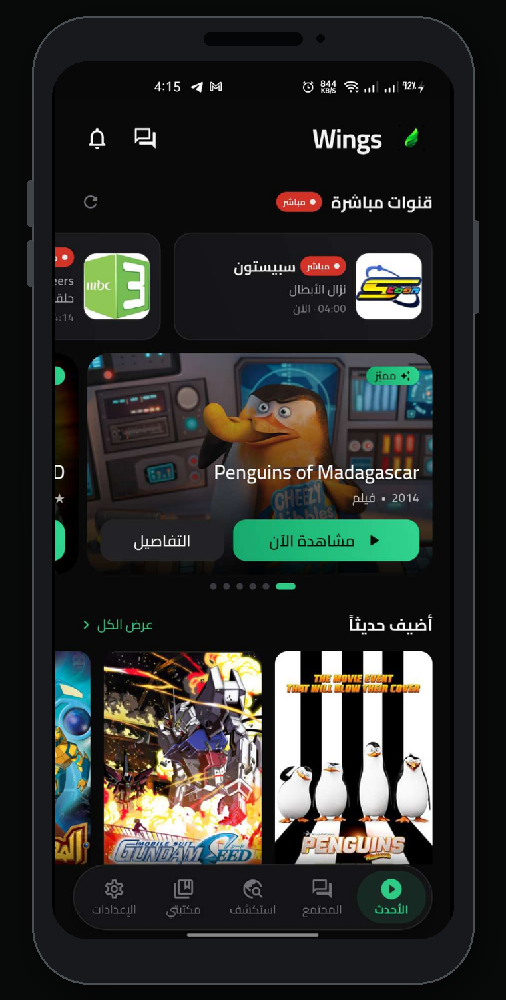
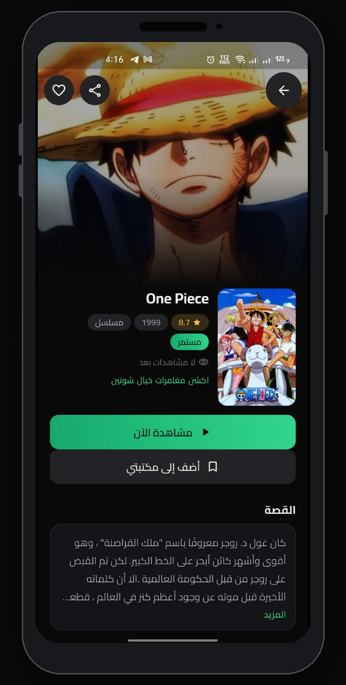
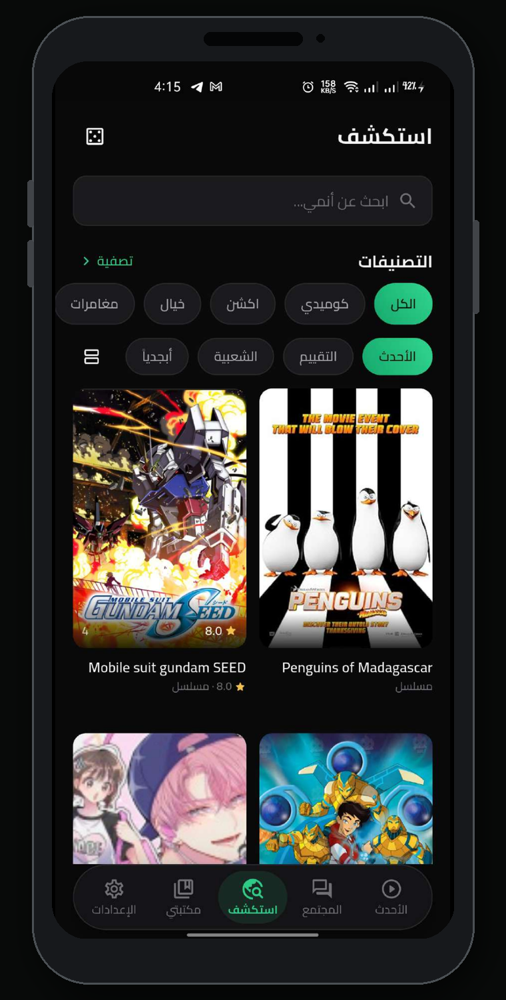
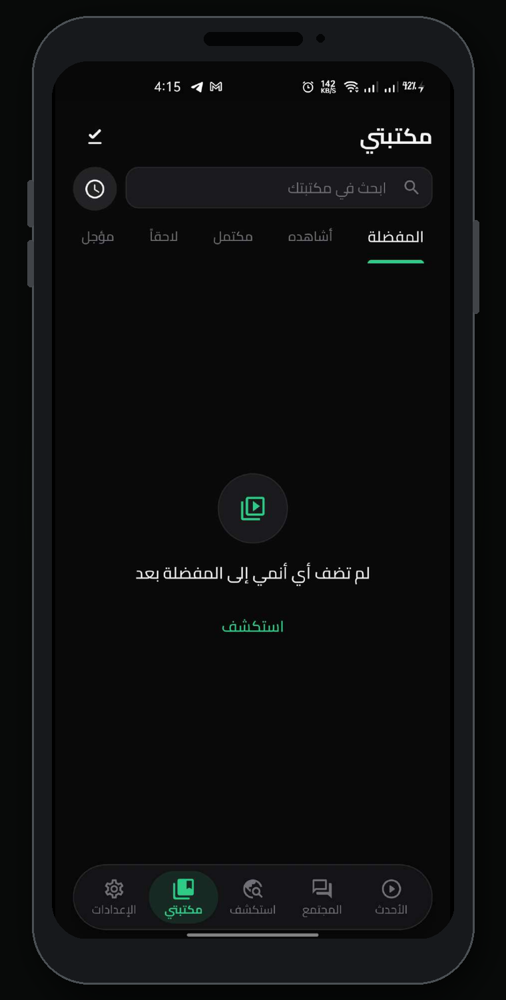
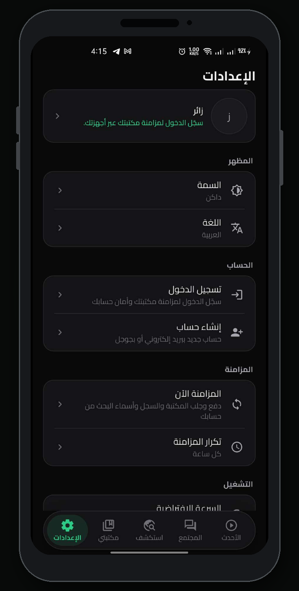

<div dir="rtl">

<p align="center">
  
</p>

<h1 align="center">Wings</h1>

<p align="center">
  <strong>تجربة أنمي عربية، بسيطة، وسريعة.</strong>
  <br />
  اكتشف أعمالك المفضلة، شاهد حلقاتك، وابنِ مكتبتك الخاصة من مكان واحد.
</p>

<p align="center">
  <a href="https://github.com/lo-oord/Wings/actions"></a>
  
  
  
  
</p>

</div>

---

## نبذة عن التطبيق

**Wings** تطبيق عربي لمشاهدة الأنمي مبني باستخدام **Flutter**. يجمع بين اكتشاف الأعمال، البحث والتصفّح، متابعة الحلقات، المشاهدة داخل التطبيق، وإدارة مكتبة شخصية بواجهة عربية كاملة واتجاه كتابة من اليمين إلى اليسار.

صُمّم التطبيق ليكون هادئًا بصريًا وسهل الاستخدام: خلفية داكنة، لمسات خضراء مستوحاة من هوية Wings، وتنقّل واضح بين أحدث المحتوى والاستكشاف والمجتمع والمكتبة والإعدادات.

> **تنبيه:** Wings واجهة وتجربة استخدام للمحتوى المتاح عبر مصادره. حقوق الأعمال محفوظة لأصحابها، وقد تختلف إتاحة المحتوى أو تتغير بحسب المصدر.

## أبرز المزايا

| الميزة | ماذا تقدم؟ |
| --- | --- |
| **اكتشاف منظم** | تصفّح أحدث الأعمال، ابحث بالاسم، واستخدم التصنيفات للعثور على ما يناسبك. |
| **صفحات تفاصيل واضحة** | معلومات العمل، التقييم، الحالة، والقصة في شاشة واحدة. |
| **مشاهدة مرنة** | مشغّل داخل التطبيق مع خيارات تشغيل مناسبة لتجربة مشاهدة أكثر سلاسة. |
| **مكتبتي** | احفظ المفضلة، راجع سجل المشاهدة، واحتفظ بما تريد متابعته لاحقًا. |
| **تنزيلات للمشاهدة دون اتصال** | إدارة التنزيلات مع إيقاف واستئناف وحذف من داخل التطبيق. |
| **تجربة عربية أولًا** | دعم RTL، خط Cairo، وتصميم متناسق في الوضع الداكن. |
| **إشعارات داخلية** | مركز إشعارات لمتابعة المستجدات والتنبيهات من داخل التطبيق. |

## داخل التطبيق

<p align="center">
  
  &nbsp;&nbsp;
  
  &nbsp;&nbsp;
  
</p>

<p align="center">
  
  &nbsp;&nbsp;
  
</p>

## البنية التقنية

يعتمد المشروع على طبقات منفصلة لتسهيل التطوير والصيانة:

```text
lib/
├── app/          التهيئة، التوجيه، الثيم، والترجمة
├── core/         الشبكة، التخزين، الأخطاء، والخدمات المشتركة
├── data/         النماذج، المصادر، والمستودعات
└── features/     الشاشات والميزات الرئيسية للتطبيق
```

### التقنيات الأساسية

- **Flutter / Dart** لبناء التطبيق.
- **Riverpod** لإدارة الحالة بطريقة قابلة للاختبار.
- **go_router** للتوجيه والتنقل بين الشاشات.
- **Hive CE** للتخزين المحلي والإعدادات والمكتبة.
- **Dio** لطلبات الشبكة وإدارة الأخطاء وإعادة المحاولة.
- **media_kit** لتشغيل الوسائط داخل التطبيق.
- **Cairo** للعرض العربي المتناسق.

## التشغيل محليًا

### المتطلبات

- Flutter SDK متوافق مع إصدار المشروع.
- Dart SDK المضمّن مع Flutter.
- Android SDK أو جهاز Android / محاكي.

### الخطوات

```bash
git clone https://github.com/lo-oord/Wings.git
cd Wings
flutter pub get
flutter gen-l10n
flutter run -d android
```

> لا تُضمّن أي مفاتيح أو كلمات مرور أو إعدادات خاصة داخل المستودع. استخدم إعدادات البيئة المحلية أو آلية الأسرار المناسبة عند الحاجة.

## الاختبارات والتحقق

```bash
dart format --output=none --set-exit-if-changed .
flutter analyze
flutter test
```

## إنشاء نسخة Android

```bash
# نسخ منفصلة للمعماريات المدعومة
flutter build apk --release --split-per-abi

# نسخة موحّدة
flutter build apk --release

# حزمة Android App Bundle
flutter build appbundle --release
```

تُحفظ المخرجات عادةً داخل:

```text
build/app/outputs/flutter-apk/
```

## المساهمة

المساهمات مرحّب بها. قبل فتح Pull Request:

1. أنشئ فرعًا واضح الاسم انطلاقًا من `main`.
2. اجعل التغيير مركزًا وسهل المراجعة.
3. حدّث الاختبارات أو أضف اختبارًا عند الحاجة.
4. شغّل `dart format` و`flutter analyze` و`flutter test`.
5. اشرح في وصف الـPull Request ما الذي تغيّر ولماذا.

## الخصوصية والأمان

- لا تضع مفاتيح API أو بيانات اعتماد أو ملفات توقيع داخل Git.
- راجع أي رابط أو مصدر بيانات قبل إضافته إلى التطبيق.
- تجنّب تضمين بيانات شخصية أو لقطات شاشة تحتوي على معلومات حسابات حقيقية.
- أبلغ عن المشكلات الأمنية بشكل خاص بدل نشر تفاصيلها علنًا.

## الترخيص وحقوق المحتوى

لا يحتوي المستودع حاليًا على ملف ترخيص مفتوح المصدر مستقل. لذلك يُرجى طلب الإذن قبل إعادة استخدام الكود أو الأصول خارج نطاق المساهمة في المشروع. أما الأعمال والصور والمحتوى المعروض داخل التطبيق فتظل حقوقها لأصحابها.

---

<p align="center">
  صُنع بعناية لمحبي الأنمي باللغة العربية — <strong>Wings</strong>
</p>
